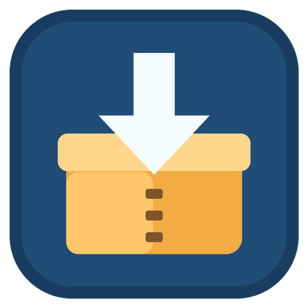

# AutoExtract 0.1.3



Windows 10/11 x64용 한국어 자동 압축 해제 트레이 앱입니다. C# / .NET 8 / WPF / MVVM으로 구현했습니다. 반디집은 별도로 설치해야 하며, 프로그램은 외부 서버 없이 동작합니다.

앱 아이콘은 직접 제작한 ‘압축 상자 + 아래쪽 화살표’ 디자인입니다. 실행 파일, 창, 시스템 트레이에 동일하게 적용합니다. `src/AutoExtract.App/Assets/`에 SVG 원본, 투명 PNG, 16–256px의 9개 크기를 포함한 ICO가 있습니다. 선택적으로 `python tools/generate_icon.py`로 PNG/ICO를 재생성할 수 있습니다(Pillow는 아이콘 개발 도구에만 필요하며 앱 실행에는 필요하지 않습니다).

0.1.1에서는 창/작업표시줄에 내장 PNG를 256px로 디코딩하여 작은 ICO 프레임이 선택되는 문제를 수정했습니다. 또한 AppContainer 안에서 반디집의 하위 폴더 생성이 실패하던 문제를 해결하기 위해, `bz l -list:s` 목록의 경로를 검사한 뒤 필요한 디렉터리를 미리 생성합니다. 추출 프로세스는 `payload`에만 쓰기 허용하며 입력 복사본은 읽기 전용으로 접근합니다.

0.1.2에서는 정상 완료한 작업의 입력 복사본·성공 로그·임시 디렉터리를 자동 정리하고, `.AutoExtract-Working`이 비면 루트도 삭제합니다. 작업 기록 탭의 **기록 전체 삭제** 버튼으로 저장된 내역을 지울 수 있습니다. 결과물과 중복 처리 방지 영수증은 유지하며, 삭제 이후 새 작업은 계속 기록합니다. 기록 저장에 실패하면 기존 내역을 복원하고 오류를 표시합니다.

0.1.3에서는 이미 트레이에 실행 중일 때 EXE를 다시 실행하면 기존 프로그램의 설정 창을 표시하고 앞으로 가져옵니다. 숨겨지거나 최소화된 창도 복원하며, 새 감시 프로세스는 만들지 않습니다. `--background` 자동 시작이 중복되면 창을 띄우지 않고 종료합니다. 사용자 전용 named pipe로 요청을 전달하며 기존 프로그램이 응답하지 않으면 안내를 표시합니다. 이 기능이 없는 이전 버전에서 업데이트할 때는 한 번 트레이에서 종료한 뒤 EXE를 교체하세요.


## 실행

1. 데스크톱용 [반디집](https://www.bandisoft.com/bandizip/)을 설치합니다. `bz.exe`가 필요합니다.
2. `artifacts/publish/win-x64/AutoExtract.exe`를 원하는 **로컬 고정 폴더**에 두고 실행합니다. Self-contained 배포본은 .NET 별도 설치가 필요 없습니다. 관리자 권한은 필요하지 않습니다.
3. ‘폴더 추가’에서 다운로드 폴더를 등록합니다. 활성/하위 폴더 포함 여부를 선택하고 **설정 저장**을 누릅니다.
4. 창을 닫으면 트레이에 남습니다. 트레이 더블클릭으로 설정을 다시 열고, ‘프로그램 종료’로 완전히 종료합니다.

기본값은 **성공 시 원본 휴지통 이동**입니다. 먼저 테스트 폴더에서 ‘원본 유지’로 확인하는 것을 권장합니다. 실행 파일을 옮겼다면 Windows 자동 실행 설정을 다시 저장하세요. 서명되지 않은 MVP 실행 파일이므로 Windows에서 게시자 확인 경고가 나타날 수 있습니다.

## 동작

- 파일 시스템 이벤트와 10초 주기 재검색을 조합합니다. 시작할 때도 기존 파일을 검색합니다. 대기 시간만으로 다운로드 완료를 판단하지 않습니다.
- 임시 다운로드 동반 파일이 있거나 쓰기 중인 파일은 대기합니다. 분할 압축은 최초 볼륨만 작업 대상으로 삼고 같은 이름의 구성 볼륨 전체를 잠급니다.
- 원본 파일은 읽기/삭제 권한의 핸들로 잠가 쓰기·삭제·교체를 막습니다. SHA-256을 스트리밍 계산하고, 같은 디스크의 비공개 작업 폴더에 입력 복사본을 만듭니다.
- `bz.exe t` 성공 → `bz.exe x` 성공 → 분할 구성/임시 파일/원본 해시 재검사 → 출력 링크 검사 순서로 진행합니다. 종료 코드가 0이 아니면 실패로 처리합니다.
- 추출은 네트워크 capability가 없는 임시 Windows AppContainer에서 실행합니다. 작업 폴더 ACL만 쓰기 허용하며, 격리가 실패하면 원본을 보존하고 작업을 중단합니다. ZIP은 경로 순회/절대 경로/ADS/링크 항목도 사전 거부합니다. 다른 형식 역시 OS 파일 접근 제한과 출력 링크 검사를 적용합니다.

  추출 전 목록의 절대 경로·상위 경로·ADS·Windows 예약 이름·유효하지 않은 문자를 검사합니다. 목록이 64MiB를 초과하면 보수적으로 자동 처리를 중단합니다. 무결성 검사/목록 프로세스는 `scratch`, 추출 프로세스는 `payload`만 쓰기 허용합니다. `bz-t.log`, `bz-l.log`, `bz-x.log`에 단계별 UTF-8 표준 출력/오류를 저장하며, 실패 기록에는 종료 코드와 오류 요약·로그 경로를 표시합니다. 로그에는 압축 내부 파일명이 포함될 수 있습니다. 정상 완료한 작업의 로그는 임시 폴더와 함께 정리하고 실패·경고·중단 로그는 보존합니다.
- 결과는 원본 옆 `압축파일명` 폴더로 같은 볼륨 내 이동합니다. 이름이 있으면 `(2)`, `(3)`을 붙입니다. 기존 폴더에 합치거나 덮어쓰지 않습니다.
- 성공 영수증을 디스크에 저장한 후, **검증한 원본의 열린 핸들 자체**로 임시 원본 보관 위치에 이동하고 휴지통에 보냅니다. 영구 삭제 옵션은 없습니다. 실패하면 원래 위치로 복구하며, 복구까지 실패하면 보관 위치를 기록합니다.
- 재시작 시 성공 기록을 읽어 중복 처리를 막습니다. 추출된 결과 폴더와 작업 폴더는 재귀 감시에서 제외됩니다. 검사 실패한 파일은 같은 실행 중 내용이 같으면 재검사하지 않으며, 내용 변경 또는 설정 저장/감시 재시작 때 재시도합니다.
- 사용자별 전역 mutex로 중복 앱 실행을 막습니다. 여러 폴더는 한 앱에 등록합니다. 기존 PowerShell 스크립트나 타사 압축 해제 프로그램과의 상호 배제는 제공하지 않으므로 동시에 감시시키지 마세요.

## 안전성과 한계

다운로드 프로그램이 파일을 닫아 둔 채 나중에 이어 쓰는지, 이미 유효한 압축파일 뒤에 데이터를 추가할 예정인지 일반 프로그램은 100% 알 수 없습니다. 이 앱은 현재 내용이 유효하고 잠금·해시·검사 조건을 통과했음을 판단합니다. 실제 완료를 외부 프로그램과 협의하지 못하므로 엄격한 보존이 필요한 환경은 **원본 유지**를 선택하세요.

잠금은 Windows 파일 공유 규칙을 준수하는 일반 프로세스의 쓰기를 막습니다. 커널 드라이버, 관리자에 의한 악의적 변경, 물리 디스크 손상이나 정전까지 보장하는 백업 도구는 아닙니다. AppContainer는 압축 경로의 기본 사용자 파일 접근을 제한하지만 Windows 자체/반디집 취약점을 해결하는 악성코드 분석 환경은 아닙니다. 최신 반디집을 사용하세요. 추출된 실행 파일을 자동 실행하지 않습니다.

- **로컬 NTFS 폴더를 지원 대상으로 합니다.** 재분석 경로(심볼릭 링크·junction), 네트워크 공유, FAT/exFAT처럼 ACL/잠금/휴지통 동작을 보장하기 어려운 위치는 처리 실패할 수 있습니다. 격리 없는 대체 실행은 하지 않습니다.
- AppContainer 안에서 읽을 수 있는 표준 Program Files 설치 반디집을 권장합니다. 사용자 지정 `bz.exe` 위치가 격리 프로세스에 읽기 허용되어 있지 않으면 실패합니다.
- 암호는 저장/요청하지 않습니다. 빈 암호를 지정하여 자동 검사하며, 암호 필요·손상·분할 누락 등은 CLI 비정상 종료로 기록합니다. 반디집은 기계 판독용 표준 오류 분류를 제공하지 않으므로 종료 코드만으로 이 원인들을 정확히 구분하지 않습니다. 중단되지 않는 CLI는 취소/종료 또는 12시간 watchdog으로 종료합니다(완료 판정 타이머가 아닙니다).
- ZIP/ZIPX/RAR/7z/EGG/ALZ/TAR와 원본 스크립트의 주요 확장자를 탐지합니다. 실제 해제 가능 여부는 설치된 반디집 버전에 따릅니다. 분할 RAR `part1.rar`, `7z.001`, `zip.001`, 구형 RAR `.rar + .r00`, ZIP `.zip + .z01`을 묶습니다. 독립 실행 파일/디스크 이미지는 자동 처리하지 않습니다.
- 대용량 파일도 메모리에 통째로 적재하지 않습니다. 안전한 복사본과 결과물만큼 추가 디스크 공간이 필요합니다. 공간 부족 시 원본을 유지하고 실패를 기록합니다. 내용 변경을 메타데이터에만 의존하지 않기 위해 SHA-256을 재계산하므로 원본 유지 모드의 대형 파일에는 추가 디스크 읽기가 발생합니다. 작업은 순차 처리되어 디스크 부하를 제한합니다.
- 검사 시 원본에 DELETE 권한이 필요합니다. 일반 읽기만 가능한 공유 폴더는 대상이 아닙니다. 열려 있는 읽기 핸들이 삭제 공유를 허용하지 않으면 다음 재검색까지 대기합니다.
- AppContainer 프로필과 작업 ACL은 작업별로 생성됩니다. 정상 종료 시 프로필을 제거합니다. 프로세스 강제 종료 시 임시 프로필이 남을 수 있습니다. 각 프로필에는 네트워크 capability가 없습니다.

## 데이터와 복구

`%LOCALAPPDATA%/AutoExtract/settings.json`: 설정. `state.json`: 성공 내용 해시, 결과 폴더 목록, 최근 500개 작업 기록. 임시 파일에 쓰고 flush한 후 교체합니다. JSON 손상 시 초기화하여 감시하는 대신 오류를 표시하고 시작을 중단합니다. 파일을 백업한 뒤 복구하세요. 앱 설정/기록에는 로컬 경로가 포함됩니다.

압축파일 옆 `.AutoExtract-Working/<작업 GUID>/`:

작업 루트 `.AutoExtract-Working`에는 Windows 숨김 속성을 적용합니다. 기본 탐색기에서는 보이지 않으며, ‘보기 → 표시 → 숨긴 항목’을 켜거나 주소창에 경로를 입력하면 확인할 수 있습니다. 이전 버전에서 생성한 작업 루트도 해당 폴더의 다음 감시 검색 때 숨김 처리합니다. 숨김은 접근 제한이나 암호화가 아니며, 복구 데이터는 그대로 보존합니다.

- `input`: 실패/중단 시 입력 복사본(정상 성공 후 정리).
- `payload`: 실패/중단 시 부분 추출 결과.
- `originals`: 휴지통 작업 중 중단되었거나 원래 경로 복구에 실패한 **검증된 원본**.

다음 감시 검색에서 `originals`에 남은 파일을 원래 폴더로 복구합니다. 같은 이름의 파일이 이미 있으면 덮어쓰지 않고 보관 경로를 안내합니다. 원본이 휴지통에 있다면 Windows 휴지통에서도 복원할 수 있습니다. 부분 결과는 자동으로 최종 결과에 합치지 않습니다.

새 버전에서 정상 완료한 작업은 원본 처리까지 끝나고 성공 영수증이 저장된 뒤 자동 정리합니다. 정리할 전체 경로를 먼저 검사하고, 링크·알 수 없는 파일·남은 `originals`가 있으면 정리를 중단합니다. 결과 폴더나 다른 작업의 디렉터리는 삭제하지 않습니다. 다른 실패/중단 작업이 남으면 최상위 `.AutoExtract-Working`도 유지합니다. 이전 버전의 잔여 작업은 완료 여부를 확정할 수 없어 자동 삭제하지 않습니다. 필요하면 앱을 종료한 뒤 확인하여 수동 정리하세요. **originals에 필요한 원본이 없는지 먼저 확인하세요.** 정리 실패는 결과물을 유지한 채 ‘성공 · 경고’로 기록합니다. 기록 전체 삭제는 이러한 복구 파일이나 원본을 삭제하지 않습니다.

전원 차단으로 결과 이동 직후 성공 기록 저장 전에 중단되면 다음 실행에서 `(2)` 결과가 생길 수 있습니다. 이 작은 구간은 원본 보존을 우선하며 기존 결과를 덮어쓰지 않습니다. 설정 기록 삭제 시 이전 작업을 새 작업으로 취급할 수 있습니다.

## 개발 / 테스트 / 배포

.NET 8 SDK와 Windows 환경이 필요합니다. 외부 애플리케이션 프레임워크/테스트 패키지는 사용하지 않습니다.

이 저장소는 소스·문서·아이콘을 관리합니다. `artifacts/`, `bin/`, `obj/`, 임시 작업 폴더와 개발용 로컬 SDK 데이터는 Git에 포함하지 않습니다. 실행 파일은 아래 publish 명령으로 생성하며, 배포 ZIP은 소스 커밋과 별도로 배포합니다.

```powershell
dotnet build src/AutoExtract.App -c Release -p:SelfContained=false -p:PublishSingleFile=false
dotnet run --project tests/AutoExtract.Tests -c Release
dotnet publish src/AutoExtract.App -c Release -r win-x64 --self-contained true -p:PublishSingleFile=true -o artifacts/publish/win-x64
```

테스트는 콘솔 테스트 러너이며 실패 시 종료 코드 1을 반환합니다. `dotnet test` 대신 위 `dotnet run` 명령을 사용합니다. 일반 사용자 Windows 세션에서 실행하세요. 테스트 산출물은 `artifacts/tests/`에 남습니다. 실제 반디집 연동 테스트에는 설치된 `bz.exe`가 필요합니다. 단일 EXE 빌드에는 Microsoft 공식 NuGet 런타임 팩 복원이 필요하고, WPF 런타임 일부는 실행 시 로컬에 풀립니다. 실행 시 네트워크는 사용하지 않습니다. 반디집 바이너리는 배포본에 포함하지 않습니다.

구조와 원본 분석은 [docs/ARCHITECTURE.md](docs/ARCHITECTURE.md), 검증 범위는 [docs/VALIDATION.md](docs/VALIDATION.md)를 참고하세요.
